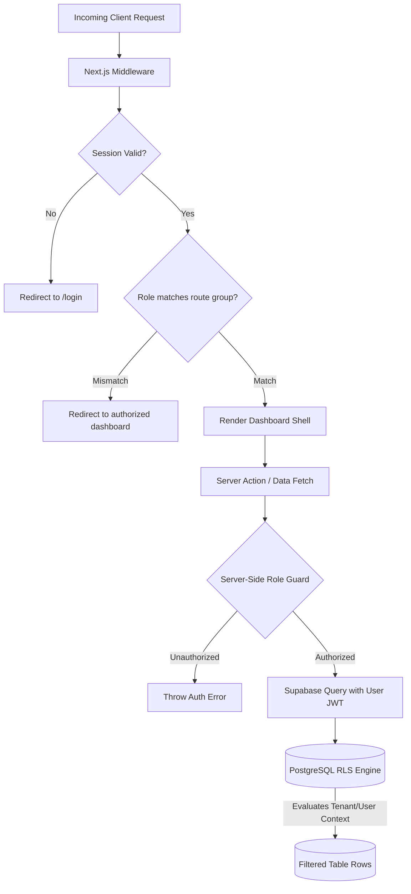
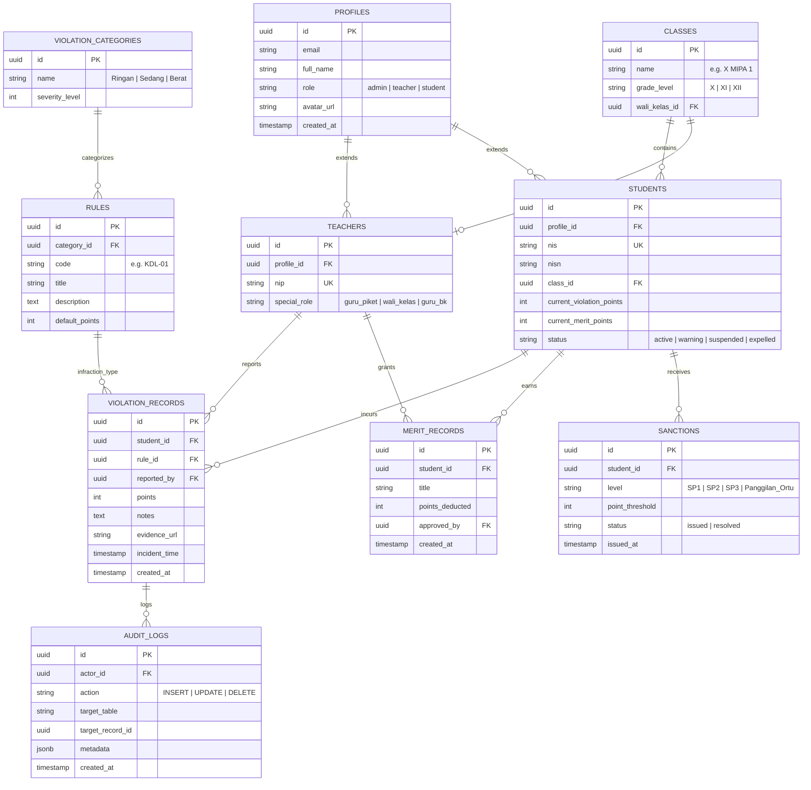
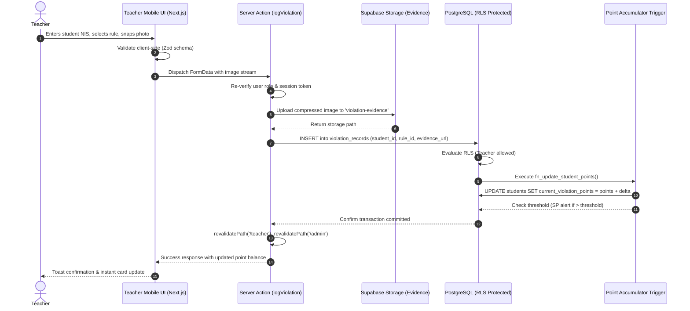

# SMADAP POINER - Complete Application Architecture Specification

## 1. Executive Summary & Design Principles

**SMADAP POINER** (Sistem Informasi Poin Pelanggaran Siswa SMADAP) is a modern, responsive web application for managing student violation and merit points in high schools.

### Core Architectural Principles
1. **Security & Data Integrity First:** School disciplinary records are sensitive legal and academic data. Row Level Security (RLS) in PostgreSQL is the single source of truth for authorization.
2. **Role-Driven User Experience:** Clean separation between administrative oversight, fast in-field reporting by teachers, and transparent accountability for students and parents.
3. **Modular Domain Isolation:** Domain-driven feature slicing to prevent monolithic coupling and allow parallel feature scaling.
4. **Optimized Next.js 15 Paradigm:** Leveraging App Router Server Components for fast initial loads and SEO (Landing Page, static catalogs), with targeted Client Components for interactive forms and camera capture.
5. **Auditability & Traceability:** Every point modification, deduction, and evidence attachment must maintain an immutable audit trail.

---

## 2. Directory & Folder Structure

```
poiner/
├── .agents/                        # Agent workflows and rules
├── graphify-out/                   # Persistent knowledge graph artifacts
├── public/                         # Public static assets
│   └── assets/                     # 3D assets, logos, videos, fallback graphics
├── src/
│   ├── app/                        # Next.js 15 App Router hierarchy
│   │   ├── (auth)/                 # Authentication route group (unauthenticated)
│   │   │   ├── login/
│   │   │   └── forgot-password/
│   │   ├── (dashboard)/            # Authenticated route group with shared sidebar/nav
│   │   │   ├── admin/              # Admin-specific routes
│   │   │   ├── teacher/            # Teacher-specific routes
│   │   │   ├── student/            # Student-specific routes
│   │   │   └── layout.tsx          # Authenticated shell layout (RBAC wrapper)
│   │   ├── (public)/               # Publicly accessible routes
│   │   │   ├── page.tsx            # Main Landing Page
│   │   │   └── rules/              # Public digital code of conduct / rulebook
│   │   ├── api/                    # Route Handlers
│   │   │   ├── auth/callback/      # Supabase OAuth/magic link exchange
│   │   │   ├── export/             # PDF / Excel report generation
│   │   │   └── webhooks/           # External webhooks
│   │   ├── globals.css             # Tailwind base styles and theme variables
│   │   └── layout.tsx              # Root HTML shell, fonts, theme provider
│   │
│   ├── components/                 # Shared & UI Component Library
│   │   ├── ui/                     # shadcn/ui primitive components (buttons, dialogs, inputs)
│   │   ├── shared/                 # Domain-agnostic reusable UI
│   │   │   ├── data-table/         # Reusable paginated & filterable table
│   │   │   ├── stat-card/          # Metric KPI cards
│   │   │   ├── file-uploader/      # Drag & drop image upload with camera preview
│   │   │   ├── status-badge/       # Status, role, and severity badges
│   │   │   └── confirm-dialog/     # Destruction and threshold confirmation modals
│   │   ├── layout/                 # Application chrome
│   │   │   ├── sidebar.tsx         # Responsive collapsible navigation
│   │   │   ├── header-nav.tsx      # Top bar, notifications, profile menu
│   │   │   ├── mobile-nav.tsx      # Bottom sheet or drawer for mobile viewports
│   │   │   └── breadcrumbs.tsx     # Dynamic navigation breadcrumbs
│   │   └── landing/                # Hero and 3D Showcase components
│   │       ├── ShieldCenterpiece.tsx
│   │       ├── Padlock3DIcon.tsx
│   │       └── QuickModals.tsx
│   │
│   ├── features/                   # Domain-Driven Feature Slices
│   │   ├── auth/                   # Authentication schemas, actions, and state
│   │   │   ├── actions/            # Server actions for login, logout, reset
│   │   │   ├── components/         # LoginForm, RoleSelector, ProtectedRoute
│   │   │   ├── hooks/              # useAuthSession, useUserRole
│   │   │   ├── schemas/            # Zod login & password validation schemas
│   │   │   └── types/              # AuthSession, UserProfile, Role types
│   │   │
│   │   ├── violations/             # Violation logging & tracking
│   │   │   ├── actions/            # logViolationAction, updateViolationAction
│   │   │   ├── components/         # ViolationForm, EvidencePreview, ViolationFeed
│   │   │   ├── hooks/              # useViolationFilters, useCameraCapture
│   │   │   ├── schemas/            # Zod violation input schema
│   │   │   └── types/              # ViolationRecord, ViolationSeverity
│   │   │
│   │   ├── merits/                 # Merit & rehabilitation point redemption
│   │   │   ├── actions/            # logMeritAction, approveRehabilitationAction
│   │   │   ├── components/         # MeritForm, MeritHistoryTable
│   │   │   └── schemas/            # Zod merit schema
│   │   │
│   │   ├── sanctions/              # Sanctions & Parent Summons (SP1, SP2, SP3)
│   │   │   ├── actions/            # issueSanctionAction, generateSummonsPDF
│   │   │   ├── components/         # SanctionTimeline, SummonsStatusCard
│   │   │   └── types/              # SanctionTier, SummonsStatus
│   │   │
│   │   ├── students/               # Student directory, profile & point history
│   │   │   ├── actions/            # getStudentDetailAction, updateStudentProfile
│   │   │   ├── components/         # StudentCard, PointScorecard, ViolationTimeline
│   │   │   └── types/              # StudentProfile, PointSummary
│   │   │
│   │   ├── rules/                  # Disciplinary rulebook catalog
│   │   │   ├── actions/            # manageRulesAction, fetchCategoriesAction
│   │   │   ├── components/         # RulesCatalogBrowser, RuleCategoryFilter
│   │   │   └── schemas/            # Zod rule catalog item schema
│   │   │
│   │   └── analytics/              # Disciplinary metrics, graphs & reports
│   │       ├── components/         # TrendChart, TopInfractionsPie, ClassRankingList
│   │       └── types/              # AnalyticsFilter, DisciplineMetrics
│   │
│   ├── lib/                        # Core utilities & client initializers
│   │   ├── supabase/               # Supabase SSR configurations
│   │   │   ├── client.ts           # Browser client (`createBrowserClient`)
│   │   │   ├── server.ts           # Server component / Action client (`createServerClient`)
│   │   │   ├── middleware.ts       # Edge middleware session client
│   │   │   └── admin.ts            # Service role privileged client (server-only)
│   │   ├── utils/                  # String formatting, cn(), date formatters (ID locale)
│   │   ├── constants/              # System point limits (e.g. SP thresholds 25, 50, 75, 100)
│   │   └── validations/            # Shared base Zod schemas (ID format, NIS regex)
│   │
│   ├── types/                      # Global TypeScript definitions
│   │   ├── database.types.ts       # Generated Supabase database schema types
│   │   └── common.ts               # PaginatedResponse, ApiResponse, ActionState
│   │
│   └── middleware.ts               # Next.js Edge Middleware for routing & role gates
│
├── .env.example                    # Environment variable contract
├── ARCHITECTURE.md                 # Complete system architecture specification
├── PROJECT_CONTEXT.md              # Project context & metadata
├── README.md                       # Repository overview & setup guide
├── next.config.mjs                 # Next.js framework configuration
├── tailwind.config.ts              # Tailwind CSS configuration with design system tokens
└── tsconfig.json                   # TypeScript path aliases & strict type settings
```

---

## 3. Route Structure & Access Control Matrix

The route structure uses Next.js App Router route groups to enforce clean isolation and distinct layout hierarchies:

| Route Pattern | Description | Layout / Wrapper | Access Level |
| :--- | :--- | :--- | :--- |
| `/` | Landing page, 3D Hero, NIS quick lookup, rulebook browser | Public Layout | Public (Guest) |
| `/rules` | Full digital handbook of school disciplinary points | Public Layout | Public (Guest) |
| `/login` | Multi-role authentication entry (Admin, Teacher, Student) | Auth Shell | Unauthenticated only |
| `/forgot-password` | Password recovery via email reset link | Auth Shell | Unauthenticated only |
| `/admin` | Admin executive discipline overview & metrics | Dashboard Layout | Admin only |
| `/admin/students` | Master student directory (CRUD, import/export) | Dashboard Layout | Admin only |
| `/admin/teachers` | Teacher and staff access assignment | Dashboard Layout | Admin only |
| `/admin/rules` | Manage violation rules catalog & point weights | Dashboard Layout | Admin only |
| `/admin/sanctions` | Monitor school-wide summons (SP1/SP2/SP3) & print letters | Dashboard Layout | Admin only |
| `/admin/audit-logs` | Immutable audit trail of points & record changes | Dashboard Layout | Admin only |
| `/teacher` | Teacher dashboard (Class summary, quick reporting) | Dashboard Layout | Teacher / Guru BK / Wali Kelas |
| `/teacher/report` | Mobile-first violation recording form with photo upload | Dashboard Layout | Teacher / Guru BK / Wali Kelas |
| `/teacher/classes` | Wali Kelas assigned student conduct monitor | Dashboard Layout | Teacher (Wali Kelas) |
| `/teacher/counseling`| BK guidance notes & rehabilitation programs | Dashboard Layout | Teacher (Guru BK) |
| `/student` | Student personal discipline & merit scorecard | Dashboard Layout | Student & Parent |
| `/student/history` | Transparent historical log of infractions & rehabilitation | Dashboard Layout | Student & Parent |
| `/student/handbook`| Digital rulebook with personal bookmarking | Dashboard Layout | Student & Parent |
| `/api/auth/callback`| Supabase Auth PKCE code exchange handler | API Route | Public |
| `/api/export/pdf` | Serverless PDF generator for official summons | API Route | Authenticated (Admin/BK) |

---

## 4. Role-Based Architecture (RBAC) & Security Strategy

The application enforces a multi-tiered security perimeter combining Next.js Middleware, Server Action guards, and PostgreSQL Row Level Security (RLS).



### Role Taxonomy & Hierarchy
1. **Admin (`admin`):**
   - Full authority over master data, school configuration, user provisioning, and point threshold overrides.
   - Access to audit logs and system configuration.
2. **Teacher (`teacher`):**
   - Sub-role **Guru Piket**: Can record violation incidents across any student during active duty.
   - Sub-role **Wali Kelas**: In-depth monitoring and reporting for students within their assigned classroom.
   - Sub-role **Guru BK (Bimbingan Konseling)**: Authority to award merit points, approve behavioral rehabilitation, and handle parent summons (Surat Panggilan).
3. **Student (`student`):**
   - Read-only access restricted strictly to their own student profile, point total, and sanctions.
   - Read access to the public disciplinary code.

### Security Layers
- **Layer 1: Edge Middleware (`src/middleware.ts`)**
  - Reads session cookie using `@supabase/ssr`.
  - Enforces route group isolation: prevents students from loading `/admin/*` or `/teacher/*`, and teachers from accessing `/admin/*`.
- **Layer 2: Server-Side Action Protection**
  - Every Server Action re-validates the user session via `createClient()` server instance.
  - Role verification utility: `assertRole(['admin', 'teacher'])`.
- **Layer 3: Database Row Level Security (RLS)**
  - Direct database enforcement. Even if client code is manipulated, PostgreSQL rejects unauthorized rows.

---

## 5. Supabase Integration Strategy & Data Architecture

### Database Schema Entity-Relationship Model



### Storage Bucket Strategy
1. **`violation-evidence` (Private Bucket):**
   - Stores photos/documents uploaded during incident reporting.
   - Upload policy: Authenticated teachers & admins only (`role in ('teacher', 'admin')`).
   - Read policy: Admins, reporting teacher, and the specific affected student/parent via Signed URLs (time-limited 1 hour).
   - Filename convention: `evidence/{academic_year}/{student_nis}/{uuid}.webp`.
2. **`student-avatars` (Public CDN Bucket):**
   - Profile images for students and teachers.
   - Upload policy: Users can only upload their own avatar (`id = auth.uid()`).

### Automated Database Functions & Triggers
- **Points Recalculation Trigger:** On `AFTER INSERT OR UPDATE` on `violation_records` or `merit_records`, a PostgreSQL stored function automatically updates `students.current_violation_points` and checks against disciplinary thresholds.
- **Sanction Trigger:** If a student's active point total passes predefined tiers (e.g., 25 → SP1, 50 → SP2, 75 → SP3, 100 → Deliberation), a row in `sanctions` is automatically queued for administrative review.

---

## 6. End-to-End Data Flow Architecture

### Violation Reporting Flow (Teacher Mobile -> Supabase DB)



### Student Point Verification Flow (Student View)
1. Student accesses `/student`.
2. Server Component fetches `students` profile joined with `violation_records` and `merit_records` via Server Supabase Client.
3. RLS limits data fetch strictly to `where profile_id = auth.uid()`.
4. Page renders instant Server-Rendered point dashboard without client-side loading spinners.

---

## 7. Shared Component & Design System Architecture

Built on **Tailwind CSS** and **shadcn/ui**, engineered with a modern SaaS aesthetic, clean typography, high contrast, and responsive mobile-first views:

### 1. Primitive UI Layer (`src/components/ui/`)
- Based on accessible Radix primitives: `Button`, `Dialog`, `Sheet`, `DropdownMenu`, `Tabs`, `Table`, `Badge`, `Card`, `Input`, `Textarea`, `Select`, `Tooltip`, `Toast`.

### 2. Domain Shared Components (`src/components/shared/`)
- `ViolationSeverityBadge`: Renders color-coded chips (Green for Merit, Yellow for Minor ≤10 pts, Orange for Moderate ≤30 pts, Red for Severe >30 pts).
- `PointCounter`: Animated numeral indicator displaying current accumulated points with threshold progress bar.
- `CameraCaptureModal`: Mobile-optimized HTML5 media device interface for instant incident photo documentation.
- `DataTablePagination`: Universal server-side paginated table with sorting, column toggle, and filter chips.
- `StudentSearchCombobox`: Debounced asynchronous autocomplete search by student name or NIS.

### 3. Application Shell (`src/components/layout/`)
- `Sidebar`: Desktop fixed sidebar with collapse states, highlighting role-relevant navigation links.
- `MobileNav`: Bottom navigation bar (Phone viewports) for high-frequency teacher tasks (Quick Log, Search, Alerts).
- `HeaderNav`: Global search, academic year switcher, active role badge, user profile drop-down, and logout handler.

---

## 8. Summary of Technical Alignment

| Dimension | Specification |
| :--- | :--- |
| **Framework** | Next.js 15 App Router (`src/app/` with Route Groups) |
| **Language** | TypeScript Strict Mode (`tsconfig.json` path aliases) |
| **Styling** | Tailwind CSS + shadcn/ui design system |
| **Icons** | Lucide React |
| **Forms & Validation** | React Hook Form + Zod (Strict client & server schemas) |
| **Authentication** | Supabase Auth (PKCE flow, SSR Cookies, Role-Based JWT) |
| **Database** | Supabase PostgreSQL with strict RLS policies & SQL Triggers |
| **Storage** | Supabase Storage (Private evidence bucket with signed URLs) |
| **Target Users** | Admin, Teacher (Wali Kelas, Guru Piket, Guru BK), Student/Parent |
| **Design Style** | Clean, Modern SaaS, Mobile-First responsive dashboard |
