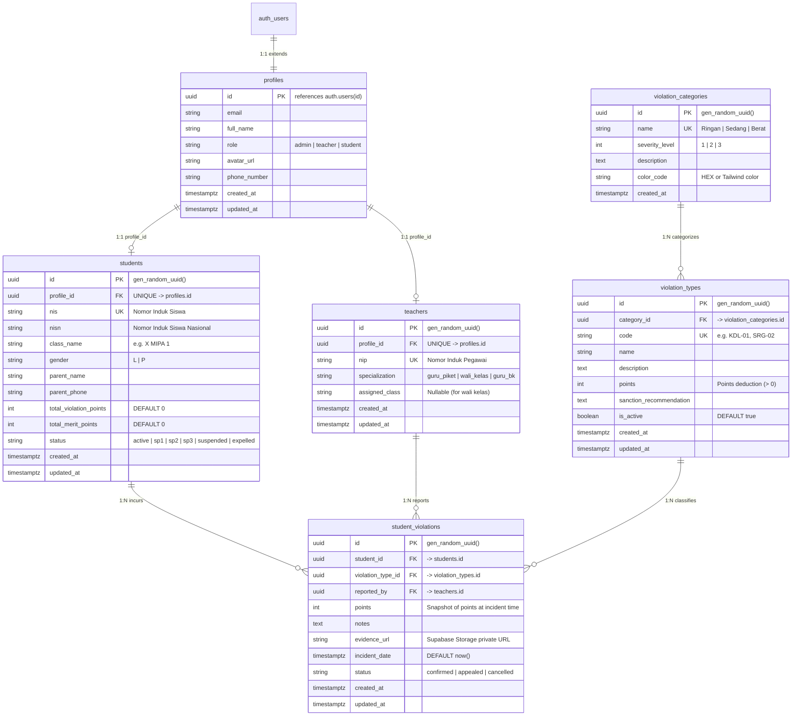

# SMADAP POINER - Complete Database Design Specification

## 1. Executive Summary & Database Architecture

The database architecture for **SMADAP POINER** is engineered on **Supabase PostgreSQL**. It manages student discipline, infractions, point balances, and access roles for high school environments.

### Core Database Architecture Principles
1. **PostgreSQL as Single Source of Truth:** Relational integrity, foreign keys, cascade rules, and check constraints enforce domain invariants at the engine layer.
2. **Strict Row Level Security (RLS):** Authorization is verified natively in PostgreSQL via Supabase Auth JWT context (`auth.uid()`).
3. **Automated Point Aggregation:** PostgreSQL stored procedures and triggers maintain total point counts and sanction statuses without relying on fragile application-level calculations.
4. **Optimized Indexing:** Targeted B-tree and composite indexes ensure sub-millisecond query execution on high-frequency mobile incident lookups and timeline feeds.

---

## 2. Entity-Relationship Diagram (ERD)



---

## 3. Entity Specifications & Relationships

### 3.1 `profiles`
- **Purpose:** Central user registry linked to Supabase Auth (`auth.users`).
- **Cardinality:**
  - `auth.users` 1:1 `profiles`
  - `profiles` 1:1 `students` (optional, if user is a student)
  - `profiles` 1:1 `teachers` (optional, if user is a teacher)
- **Cascading Rules:** `ON DELETE CASCADE` from `auth.users`. Deleting the authentication user deletes their application profile.

### 3.2 `students`
- **Purpose:** Stores student academic records, classroom assignment, and aggregated disciplinary points.
- **Cardinality:**
  - `profiles` 1:1 `students`
  - `students` 1:N `student_violations`
- **Cascading Rules:**
  - Foreign key to `profiles(id)`: `ON DELETE CASCADE`.
  - Referenced by `student_violations(student_id)`: `ON DELETE CASCADE`.

### 3.3 `teachers`
- **Purpose:** Stores teacher credentials, school staff role (Piket, Wali Kelas, BK), and classroom assignments.
- **Cardinality:**
  - `profiles` 1:1 `teachers`
  - `teachers` 1:N `student_violations` (as reporting staff)
- **Cascading Rules:**
  - Foreign key to `profiles(id)`: `ON DELETE CASCADE`.
  - Referenced by `student_violations(reported_by)`: `ON DELETE SET NULL` (preserves historical incident records even if a teacher account is removed).

### 3.4 `violation_categories`
- **Purpose:** Top-level categorization of school rule infractions (*Ringan*, *Sedang*, *Berat*).
- **Cardinality:**
  - `violation_categories` 1:N `violation_types`
- **Cascading Rules:**
  - Referenced by `violation_types(category_id)`: `ON DELETE RESTRICT` (cannot delete a category if active rules reference it).

### 3.5 `violation_types`
- **Purpose:** Specific infraction catalog (rule items, point penalties, standard guidance).
- **Cardinality:**
  - `violation_categories` 1:N `violation_types`
  - `violation_types` 1:N `student_violations`
- **Cascading Rules:**
  - Referenced by `student_violations(violation_type_id)`: `ON DELETE RESTRICT` (rules with logged violations cannot be deleted; they must be marked `is_active = false`).

### 3.6 `student_violations`
- **Purpose:** Individual violation incident log connecting a student, a rule, and the reporting teacher with attached evidence.
- **Cardinality:**
  - `students` 1:N `student_violations`
  - `violation_types` 1:N `student_violations`
  - `teachers` 1:N `student_violations`

---

## 4. Constraints & Data Integrity Rules

| Table | Constraint Name | Type | Specification / Rule |
| :--- | :--- | :--- | :--- |
| `profiles` | `pk_profiles` | PRIMARY KEY | `id` |
| `profiles` | `fk_profiles_auth_users` | FOREIGN KEY | `id REFERENCES auth.users(id) ON DELETE CASCADE` |
| `profiles` | `chk_profiles_role` | CHECK | `role IN ('admin', 'teacher', 'student')` |
| `profiles` | `chk_profiles_email_not_empty` | CHECK | `length(trim(email)) > 3` |
| `students` | `pk_students` | PRIMARY KEY | `id` |
| `students` | `fk_students_profile` | FOREIGN KEY | `profile_id REFERENCES profiles(id) ON DELETE CASCADE` |
| `students` | `uq_students_profile_id` | UNIQUE | `profile_id` |
| `students` | `uq_students_nis` | UNIQUE | `nis` |
| `students` | `chk_students_points_non_negative` | CHECK | `total_violation_points >= 0 AND total_merit_points >= 0` |
| `students` | `chk_students_status` | CHECK | `status IN ('active', 'sp1', 'sp2', 'sp3', 'suspended', 'expelled')` |
| `students` | `chk_students_gender` | CHECK | `gender IN ('L', 'P')` |
| `teachers` | `pk_teachers` | PRIMARY KEY | `id` |
| `teachers` | `fk_teachers_profile` | FOREIGN KEY | `profile_id REFERENCES profiles(id) ON DELETE CASCADE` |
| `teachers` | `uq_teachers_profile_id` | UNIQUE | `profile_id` |
| `teachers` | `uq_teachers_nip` | UNIQUE | `nip` |
| `teachers` | `chk_teachers_specialization` | CHECK | `specialization IN ('guru_piket', 'wali_kelas', 'guru_bk')` |
| `violation_categories` | `pk_violation_categories` | PRIMARY KEY | `id` |
| `violation_categories` | `uq_violation_categories_name` | UNIQUE | `name` |
| `violation_categories` | `chk_violation_categories_severity` | CHECK | `severity_level IN (1, 2, 3)` |
| `violation_types` | `pk_violation_types` | PRIMARY KEY | `id` |
| `violation_types` | `fk_violation_types_category` | FOREIGN KEY | `category_id REFERENCES violation_categories(id) ON DELETE RESTRICT` |
| `violation_types` | `uq_violation_types_code` | UNIQUE | `code` |
| `violation_types` | `chk_violation_types_points` | CHECK | `points > 0` |
| `student_violations` | `pk_student_violations` | PRIMARY KEY | `id` |
| `student_violations` | `fk_student_violations_student` | FOREIGN KEY | `student_id REFERENCES students(id) ON DELETE CASCADE` |
| `student_violations` | `fk_student_violations_type` | FOREIGN KEY | `violation_type_id REFERENCES violation_types(id) ON DELETE RESTRICT` |
| `student_violations` | `fk_student_violations_teacher` | FOREIGN KEY | `reported_by REFERENCES teachers(id) ON DELETE SET NULL` |
| `student_violations` | `chk_student_violations_points` | CHECK | `points > 0` |
| `student_violations` | `chk_student_violations_status` | CHECK | `status IN ('confirmed', 'appealed', 'cancelled')` |

---

## 5. Indexing Strategy

B-tree and composite indexes are deployed to ensure optimal performance for high-throughput and filter-intensive operations:

| Index Name | Table | Columns | Purpose |
| :--- | :--- | :--- | :--- |
| `idx_profiles_role` | `profiles` | `role` | Optimizes role-based queries and JWT profile checks |
| `idx_profiles_email` | `profiles` | `email` | Rapid lookup during login/invitation validation |
| `idx_students_nis` | `students` | `nis` | Instant lookup on public landing page and search comboboxes |
| `idx_students_class` | `students` | `class_name` | Speeds up class-filtered lists for Wali Kelas |
| `idx_students_status` | `students` | `status` | Filters students currently under active sanctions (SP1/SP2/SP3) |
| `idx_students_points` | `students` | `total_violation_points DESC` | Accelerates discipline ranking queries and admin dashboards |
| `idx_teachers_nip` | `teachers` | `nip` | Instant identification for teacher authentication |
| `idx_teachers_specialization` | `teachers` | `specialization` | Queries targeting specific staff roles (Guru BK, Piket) |
| `idx_violation_types_category` | `violation_types` | `category_id` | Foreign key index for catalog filtering by severity |
| `idx_violation_types_code` | `violation_types` | `code` | Quick autocomplete when typing rule code (e.g. KDL-01) |
| `idx_violation_types_active` | `violation_types` | `is_active` | Partial / filtered index for student-facing rulebook display |
| `idx_violations_student_date` | `student_violations` | `(student_id, incident_date DESC)` | **Composite Index:** Critical for student timeline & history pagination |
| `idx_violations_reported_by` | `student_violations` | `reported_by` | Filters incidents reported by a specific teacher |
| `idx_violations_type` | `student_violations` | `violation_type_id` | Aggregates most frequent infraction types for school analytics |
| `idx_violations_status` | `student_violations` | `status` | Filters confirmed vs appealed infractions |

---

## 6. Supabase Row Level Security (RLS) Strategy

Row Level Security is enabled on every table (`ALTER TABLE ... ENABLE ROW LEVEL SECURITY`). Authorization is verified using helper functions reading the user's role from `profiles`:

```sql
-- Helper function to extract user role from profiles
CREATE OR REPLACE FUNCTION auth.get_user_role()
RETURNS TEXT AS $$
  SELECT role FROM public.profiles WHERE id = auth.uid();
$$ LANGUAGE sql STABLE SECURITY DEFINER;
```

### 6.1 `profiles` RLS Policies
- **SELECT:**
  - Users can read their own profile (`id = auth.uid()`).
  - Teachers and Admins can view all profiles (`auth.get_user_role() IN ('admin', 'teacher')`).
- **INSERT:**
  - Automated via Supabase Auth signup trigger (`SECURITY DEFINER`).
  - Direct insert restricted to Admins (`auth.get_user_role() = 'admin'`).
- **UPDATE:**
  - Users can update their own profile fields (e.g., `avatar_url`, `phone_number`).
  - Only Admins can modify the `role` column.
- **DELETE:**
  - Admins only.

### 6.2 `students` RLS Policies
- **SELECT:**
  - Student: Can view only their own record (`profile_id = auth.uid()`).
  - Teacher: Can view all students (`auth.get_user_role() = 'teacher'`).
  - Admin: Full access (`auth.get_user_role() = 'admin'`).
- **INSERT / DELETE:**
  - Admins only.
- **UPDATE:**
  - Admins can update all columns.
  - Teachers (specifically Guru BK) can update counseling notes or class allocations.
  - Direct mutation of `total_violation_points` by clients is revoked (managed strictly by database triggers).

### 6.3 `teachers` RLS Policies
- **SELECT:**
  - Authenticated users can view basic teacher details (required to display reporter names on violation records).
- **INSERT / UPDATE / DELETE:**
  - Admins only.

### 6.4 `violation_categories` & `violation_types` RLS Policies
- **SELECT:**
  - All authenticated users and public guests can read active rules (`is_active = true`).
- **INSERT / UPDATE / DELETE:**
  - Admins only.

### 6.5 `student_violations` RLS Policies
- **SELECT:**
  - Student: Can view only incidents where `student_id IN (SELECT id FROM students WHERE profile_id = auth.uid())`.
  - Teacher: Can view all school violation records.
  - Admin: Full read access.
- **INSERT:**
  - Teachers and Admins only (`auth.get_user_role() IN ('teacher', 'admin')`).
  - `reported_by` must match the authenticated teacher's ID or be set by admin.
- **UPDATE:**
  - Reporting teacher can update notes/evidence within 24 hours of creation.
  - Guru BK and Admins can update status (e.g., approve appeal or mark cancelled).
- **DELETE:**
  - Admins only.

---

## 7. Automated Stored Procedures & Triggers

To prevent race conditions and ensure immutable point balances, points aggregation and sanction status updates are executed inside PostgreSQL transactions.

### 7.1 Point Recalculation Trigger Function
When a row in `student_violations` is inserted, updated, or deleted, recalculate the student's active point total:

```sql
CREATE OR REPLACE FUNCTION public.fn_sync_student_violation_points()
RETURNS TRIGGER AS $$
DECLARE
  v_student_id UUID;
  v_total_points INT;
  v_new_status TEXT;
BEGIN
  IF (TG_OP = 'DELETE') THEN
    v_student_id := OLD.student_id;
  ELSE
    v_student_id := NEW.student_id;
  END IF;

  -- Calculate sum of confirmed violation points
  SELECT COALESCE(SUM(points), 0)
  INTO v_total_points
  FROM public.student_violations
  WHERE student_id = v_student_id AND status = 'confirmed';

  -- Determine sanction threshold
  IF v_total_points >= 100 THEN
    v_new_status := 'expelled';
  ELSIF v_total_points >= 75 THEN
    v_new_status := 'sp3';
  ELSIF v_total_points >= 50 THEN
    v_new_status := 'sp2';
  ELSIF v_total_points >= 25 THEN
    v_new_status := 'sp1';
  ELSE
    v_new_status := 'active';
  END IF;

  -- Atomic update on student record
  UPDATE public.students
  SET 
    total_violation_points = v_total_points,
    status = v_new_status,
    updated_at = NOW()
  WHERE id = v_student_id;

  RETURN NULL;
END;
$$ LANGUAGE plpgsql SECURITY DEFINER;

CREATE TRIGGER trg_sync_student_violation_points
AFTER INSERT OR UPDATE OR DELETE ON public.student_violations
FOR EACH ROW EXECUTE FUNCTION public.fn_sync_student_violation_points();
```

---

## 8. Complete PostgreSQL DDL Script

```sql
-- 1. Enable UUID Extension
CREATE EXTENSION IF NOT EXISTS "uuid-ossp";

-- 2. Create Tables
CREATE TABLE public.profiles (
    id UUID PRIMARY KEY REFERENCES auth.users(id) ON DELETE CASCADE,
    email VARCHAR(255) NOT NULL,
    full_name VARCHAR(255) NOT NULL,
    role VARCHAR(20) NOT NULL DEFAULT 'student',
    avatar_url TEXT,
    phone_number VARCHAR(20),
    created_at TIMESTAMPTZ NOT NULL DEFAULT NOW(),
    updated_at TIMESTAMPTZ NOT NULL DEFAULT NOW(),
    CONSTRAINT chk_profiles_role CHECK (role IN ('admin', 'teacher', 'student')),
    CONSTRAINT chk_profiles_email_not_empty CHECK (length(trim(email)) > 3)
);

CREATE TABLE public.students (
    id UUID PRIMARY KEY DEFAULT gen_random_uuid(),
    profile_id UUID NOT NULL UNIQUE REFERENCES public.profiles(id) ON DELETE CASCADE,
    nis VARCHAR(20) NOT NULL UNIQUE,
    nisn VARCHAR(20) UNIQUE,
    class_name VARCHAR(50) NOT NULL,
    gender VARCHAR(1) NOT NULL,
    parent_name VARCHAR(255),
    parent_phone VARCHAR(20),
    total_violation_points INT NOT NULL DEFAULT 0,
    total_merit_points INT NOT NULL DEFAULT 0,
    status VARCHAR(20) NOT NULL DEFAULT 'active',
    created_at TIMESTAMPTZ NOT NULL DEFAULT NOW(),
    updated_at TIMESTAMPTZ NOT NULL DEFAULT NOW(),
    CONSTRAINT chk_students_points_non_negative CHECK (total_violation_points >= 0 AND total_merit_points >= 0),
    CONSTRAINT chk_students_status CHECK (status IN ('active', 'sp1', 'sp2', 'sp3', 'suspended', 'expelled')),
    CONSTRAINT chk_students_gender CHECK (gender IN ('L', 'P'))
);

CREATE TABLE public.teachers (
    id UUID PRIMARY KEY DEFAULT gen_random_uuid(),
    profile_id UUID NOT NULL UNIQUE REFERENCES public.profiles(id) ON DELETE CASCADE,
    nip VARCHAR(30) NOT NULL UNIQUE,
    specialization VARCHAR(30) NOT NULL DEFAULT 'guru_piket',
    assigned_class VARCHAR(50),
    created_at TIMESTAMPTZ NOT NULL DEFAULT NOW(),
    updated_at TIMESTAMPTZ NOT NULL DEFAULT NOW(),
    CONSTRAINT chk_teachers_specialization CHECK (specialization IN ('guru_piket', 'wali_kelas', 'guru_bk'))
);

CREATE TABLE public.violation_categories (
    id UUID PRIMARY KEY DEFAULT gen_random_uuid(),
    name VARCHAR(50) NOT NULL UNIQUE,
    severity_level INT NOT NULL,
    description TEXT,
    color_code VARCHAR(20) DEFAULT '#f59e0b',
    created_at TIMESTAMPTZ NOT NULL DEFAULT NOW(),
    CONSTRAINT chk_violation_categories_severity CHECK (severity_level IN (1, 2, 3))
);

CREATE TABLE public.violation_types (
    id UUID PRIMARY KEY DEFAULT gen_random_uuid(),
    category_id UUID NOT NULL REFERENCES public.violation_categories(id) ON DELETE RESTRICT,
    code VARCHAR(20) NOT NULL UNIQUE,
    name VARCHAR(255) NOT NULL,
    description TEXT,
    points INT NOT NULL,
    sanction_recommendation TEXT,
    is_active BOOLEAN NOT NULL DEFAULT TRUE,
    created_at TIMESTAMPTZ NOT NULL DEFAULT NOW(),
    updated_at TIMESTAMPTZ NOT NULL DEFAULT NOW(),
    CONSTRAINT chk_violation_types_points CHECK (points > 0)
);

CREATE TABLE public.student_violations (
    id UUID PRIMARY KEY DEFAULT gen_random_uuid(),
    student_id UUID NOT NULL REFERENCES public.students(id) ON DELETE CASCADE,
    violation_type_id UUID NOT NULL REFERENCES public.violation_types(id) ON DELETE RESTRICT,
    reported_by UUID REFERENCES public.teachers(id) ON DELETE SET NULL,
    points INT NOT NULL,
    notes TEXT,
    evidence_url TEXT,
    incident_date TIMESTAMPTZ NOT NULL DEFAULT NOW(),
    status VARCHAR(20) NOT NULL DEFAULT 'confirmed',
    created_at TIMESTAMPTZ NOT NULL DEFAULT NOW(),
    updated_at TIMESTAMPTZ NOT NULL DEFAULT NOW(),
    CONSTRAINT chk_student_violations_points CHECK (points > 0),
    CONSTRAINT chk_student_violations_status CHECK (status IN ('confirmed', 'appealed', 'cancelled'))
);

-- 3. Create Indexes
CREATE INDEX idx_profiles_role ON public.profiles(role);
CREATE INDEX idx_profiles_email ON public.profiles(email);

CREATE INDEX idx_students_nis ON public.students(nis);
CREATE INDEX idx_students_class ON public.students(class_name);
CREATE INDEX idx_students_status ON public.students(status);
CREATE INDEX idx_students_points ON public.students(total_violation_points DESC);

CREATE INDEX idx_teachers_nip ON public.teachers(nip);
CREATE INDEX idx_teachers_specialization ON public.teachers(specialization);

CREATE INDEX idx_violation_types_category ON public.violation_types(category_id);
CREATE INDEX idx_violation_types_code ON public.violation_types(code);
CREATE INDEX idx_violation_types_active ON public.violation_types(is_active);

CREATE INDEX idx_violations_student_date ON public.student_violations(student_id, incident_date DESC);
CREATE INDEX idx_violations_reported_by ON public.student_violations(reported_by);
CREATE INDEX idx_violations_type ON public.student_violations(violation_type_id);
CREATE INDEX idx_violations_status ON public.student_violations(status);

-- 4. Enable Row Level Security
ALTER TABLE public.profiles ENABLE ROW LEVEL SECURITY;
ALTER TABLE public.students ENABLE ROW LEVEL SECURITY;
ALTER TABLE public.teachers ENABLE ROW LEVEL SECURITY;
ALTER TABLE public.violation_categories ENABLE ROW LEVEL SECURITY;
ALTER TABLE public.violation_types ENABLE ROW LEVEL SECURITY;
ALTER TABLE public.student_violations ENABLE ROW LEVEL SECURITY;
```
