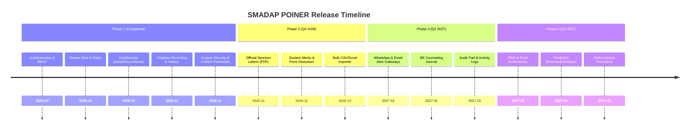

# Project Roadmap: SMADAP POINER

**Project:** SMADAP POINER (Sistem Manajemen Disiplin & Poin Pelanggaran Siswa)  
**Institution:** SMAN 2 PANGKEP  
**Document Version:** 1.0.0  
**Updated:** 2026-11-02  

---

## 1. Vision & Strategic Goals

SMADAP POINER transforms school discipline governance at **SMAN 2 PANGKEP** from subjective manual pen-and-paper tracking into a transparent, quantifiable, and positive-intervention ecosystem.

### Key Strategic Pillars:
1. **Accountability & Transparency**: Real-time visibility into student discipline for administrators, teachers, and students.
2. **Standardized Sanction Ladders**: Clear escalation from counseling to disciplinary board summons based on deterministic point accumulation (`Aman`, `SP1`, `SP2`, `SP3`).
3. **Restorative Discipline (Pemutihan Poin)**: Empower students to rehabilitate their record through academic, athletic, and extracurricular achievements.
4. **Guardian Collaboration**: Immediate proactive communication between school authority and parents to prevent chronic absenteeism or expulsion.

---

## 2. Release Phases & Timeline

---

## 3. Phase Breakdown & Deliverables

### Phase 1: Core System Foundation & Security *(Completed - v1.0.0-RC1)*
- [x] **Authentication & Role-Based Access Control**:
  - Multi-portal login (`/admin`, `/guru`, `/siswa`) with session cookie handling.
  - Edge middleware, route-level guards, and server action assertions.
- [x] **Master Data Management**:
  - Admin management for rules/categories, teachers (auto-auth provisioning), and students (NISN, class, major).
- [x] **Operational Portals**:
  - **Admin Dashboard**: System metrics, monthly violation trend visualizers, and recent feeds.
  - **Teacher Portal**: Personal submission counters, quick-violation modal, and incident logging workflow.
  - **Student Portal**: Point balance gauge, disciplinary status card, and chronological infraction history.
- [x] **Unified Disciplinary Engine**:
  - Standardized scale: `0-35 Aman`, `36-75 SP1`, `76-150 SP2`, `151+ SP3`.
- [x] **Security & RLS**:
  - Production PostgreSQL Row-Level Security migration script ([`supabase/migrations/20261102_security_rls_layer.sql`](file:///home/anrigupa/Desktop/poiner/supabase/migrations/20261102_security_rls_layer.sql)).

---

### Phase 2: Restorative Governance & Automation *(Q4 2026 - In Progress)*

#### 2.1 Official Sanction Letter PDF Generator (Surat Panggilan SP)
- **Objective**: Generate official printable warning letters formatted according to SMAN 2 PANGKEP administrative standards.
- **Deliverables**:
  - Server-side PDF generation engine (using `@react-pdf/renderer` or native SVG-to-PDF).
  - Letter templates for SP1 (Wali Kelas & Guru BK), SP2 (Kesiswaan), and SP3 (Kepala Sekolah & Skorsing).
  - Dynamic infraction table embed, session citation date, and dual-signature verification blocks (Principal & Guardian).
  - Download trigger in `/admin/students` and `/guru`.

#### 2.2 Student Merits & Point Deduction Workflow (`/siswa/merits` & `/admin/merits`)
- **Objective**: Implement restorative justice by rewarding extracurricular and academic excellence.
- **Deliverables**:
  - Catalog of positive behaviors and merit points (Juara Lomba, Paskibra, OSIS, Tahfidz).
  - Student evidence submission form (certificate image/PDF upload).
  - Admin/Kesiswaan approval queue (`/admin/merits/pending`).
  - Automatic balance deduction: `total_violation_points - approved_merit_points` and dynamic status re-calculation.

#### 2.3 Bulk CSV/Excel Importer
- **Objective**: Accelerate academic year rollover and data ingestion.
- **Deliverables**:
  - Drag-and-drop CSV parser for student rosters and teacher rosters.
  - Dry-run validation matrix highlighting duplicates (duplicate NISN/NIP) and format errors before committing.
  - Batch commit into Supabase PostgreSQL.

---

### Phase 3: Parent Communication & Counseling Workspace *(Q1 2027)*

#### 3.1 WhatsApp & Email Guardian Alert System
- **Objective**: Inform parents in real-time when incidents occur or when sanction levels escalate.
- **Deliverables**:
  - Integration with WhatsApp Cloud API / Twilio SMS gateway.
  - Automated message dispatch triggered on severe infractions (>15 points) or level changes (e.g. crossing into SP1).
  - Delivery logs and failure retry queue.

#### 3.2 BK Counseling Journal (`/guru/counseling`)
- **Objective**: Equip Guidance & Counseling (Guru BK) staff with case management tools.
- **Deliverables**:
  - Confidential counseling session logs linked to students on SP1/SP2/SP3.
  - Progress tracking (attitude improvement, parent conference outcomes, follow-up deadlines).
  - Granular access control ensuring session notes remain strictly between BK counselors and administrators.

#### 3.3 Database Audit Trail
- **Objective**: Meet compliance and anti-tampering standards for disciplinary records.
- **Deliverables**:
  - Dedicated PostgreSQL `audit_logs` table tracking mutations, manual point overrides, and account resets.
  - Admin audit viewer at `/admin/audit`.

---

### Phase 4: Mobile Experience & Predictive Analytics *(Q2 2027)*

#### 4.1 Progressive Web App (PWA) & Native Notifications
- **Objective**: Mobile-first field reporting for teachers conducting morning gate or schoolyard inspections.
- **Deliverables**:
  - Web manifest and service worker configuration.
  - Offline report queuing that syncs automatically when internet connectivity returns.

#### 4.2 Disciplinary Risk & Trend Analytics
- **Objective**: Preventive early intervention using statistical analysis.
- **Deliverables**:
  - Pattern detection (e.g., classes or times of day with high tardiness).
  - Early-warning dashboard highlighting students accumulating infractions rapidly before reaching SP thresholds.

---

## 4. Key Performance Indicators (KPIs)

| Metric | Baseline (Pre-POINER) | Target (Phase 2 & 3) |
| :--- | :--- | :--- |
| **Violation Log Time** | 2-3 business days (paper form) | < 60 seconds (mobile quick-log) |
| **Sanction Letter Dispatch** | 1-2 weeks manual drafting | Instant 1-click PDF export |
| **Point Discrepancies & Disputes** | Common (unrecorded paper slips) | 0 (immutable digital ledger) |
| **Parent Awareness Window** | 2-4 weeks after escalation | Immediate (< 5 minutes via alert) |
| **Student Rehabilitation Rate** | Low (no structured merit system) | > 35% of SP1 students reducing points via merits |

---

*Maintained by the SMAN 2 PANGKEP System Engineering Team.*
